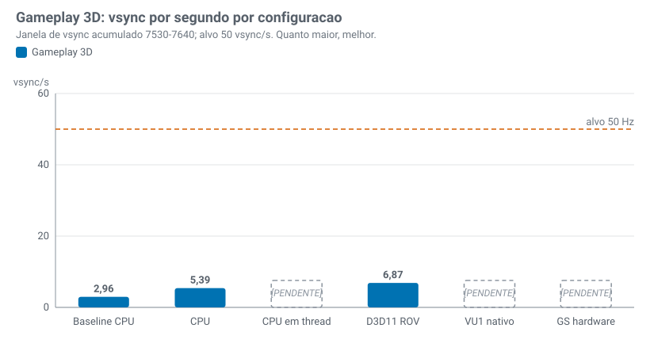
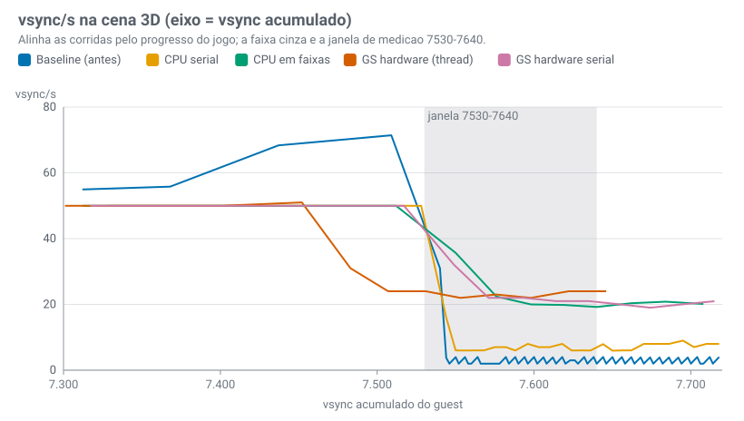
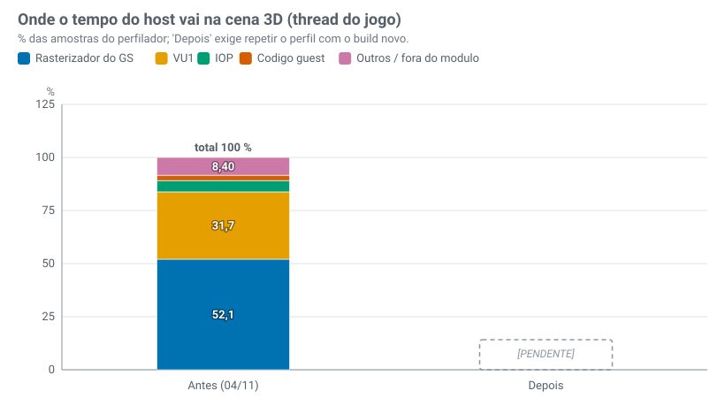
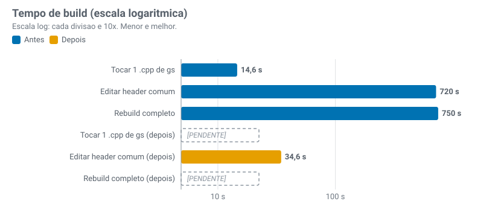
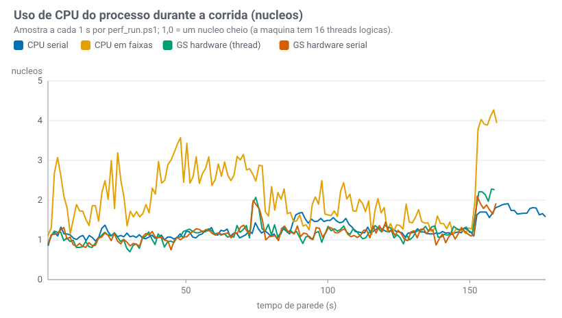

# ghost_pc — Ghost in the Shell: Stand Alone Complex (PS2) → PC

> **Estudo de caso / Case study**
>
> **PT-BR:** este projeto é apenas um estudo de caso, uma pesquisa pessoal sobre recompilação estática e engenharia reversa, e não um produto. O desenvolvimento só continuará no meu tempo disponível, quando possível: sem prazos, sem garantia de conclusão e sem suporte.
>
> **EN:** this project is only a case study, personal research into static recompilation and reverse engineering, not a product. Development will only continue in my available time, when possible: no deadlines, no guarantee of completion and no support.

Port do jogo (PS2, versão Europa `SLES_530.20`) por recompilação estática. Repositório do jogo; a base genérica está em **ps2_recomp** (`HayatoG/ps2_recomp`).

> **Público e sem conteúdo do jogo.** Nada de ISO, ELF, texturas, áudio ou vídeo: só código, patches, notas de engenharia reversa (endereços, nomes, formatos) e scripts. É preciso o **dump original** (`*.iso` nesta pasta); o launcher confere serial e sha256 do ELF de boot.

## Conteúdo
| Pasta/arquivo | O quê |
|---|---|
| `AGENTS.md` | Alvo, layout, estado e como rodar as ferramentas |
| `game.toml` | Configuração do launcher (serial, hash do ELF, arquivos a extrair, executável, região PAL) |
| `docs/` | Notas de RE: módulos IOP, sequência de boot do IOP, contêiner `fpk`, `V3a` e `zim`, nomes de funções (`symbols*.csv`), spike do PS2Recomp |
| `patches/` | Alterações ao runtime do PS2Recomp (pad virtual, medidor de FPS, capturas de tela, vblank por região, opção sem LTCG, registro de alvos ausentes) |
| `pad_scripts/` | Scripts de entrada do gamepad virtual (por quadro) |

## Como rodar (a partir da raiz do repositório genérico)
```
python -I launcher/ps2launcher.py verify --game ghost_pc
python -I launcher/ps2launcher.py run --game ghost_pc --fps 60 --pad-script ghost_pc/pad_scripts/smoke.txt --shot-dir ghost_pc/logs/shots
```

## Estado
O recompilador converte o ELF inteiro e o runtime abre a janela, mas o jogo **ainda não desenha** (quadro magenta). Detalhes e próximos passos em `AGENTS.md` e `docs/ps2recomp-spike.md`.

## Desempenho
Relatório completo (metodologia, antes/depois, build, CPU/RAM/GPU, pendências): [`docs/relatorio-performance.md`](docs/relatorio-performance.md). Dados e fontes: `docs/perf/data.json`. Gráficos regenerados por `powershell -NoProfile -File tools\make_report.ps1`.









Medição final (05/11, exe congelado, cena 3D, janela de vsync 7530-7640): **2,96 -> 22,95 vsync/s (~7,8x)**, com CPU serial 7,15, CPU em faixas 22,12, GS por hardware 22,95 (serial 22,71). **Ainda ~2x abaixo do alvo de 50 vsync/s.** Uma corrida por configuração, CSV de 1 s e janela por interpolação (ressalvas no relatório). Editar um header comum: 12+ min -> 34,6 s.



Itens ainda **[PENDENTE]**: menu de idioma com o build novo, custo do CRT, tocar 1 `.cpp` de gs, link do `build_dev`.

## Licença dos patches
Os arquivos em `patches/` são derivados do PS2Recomp e seguem a **GPL-3.0**.

## Licença

GPL-3.0 (ver `LICENSE`), pois o runtime e os patches derivam do PS2Recomp. Direitos autorais do jogo ficam com os titulares; nada do jogo é versionado. Detalhes e checklist de publicação em `docs/LEGAL.md`.
