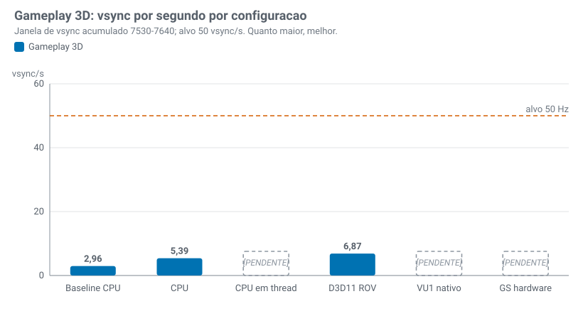
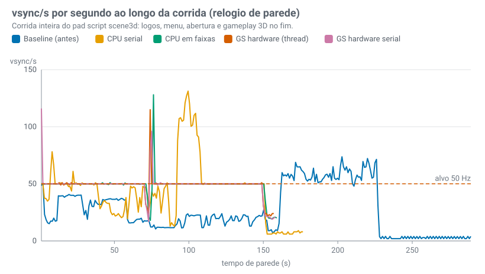
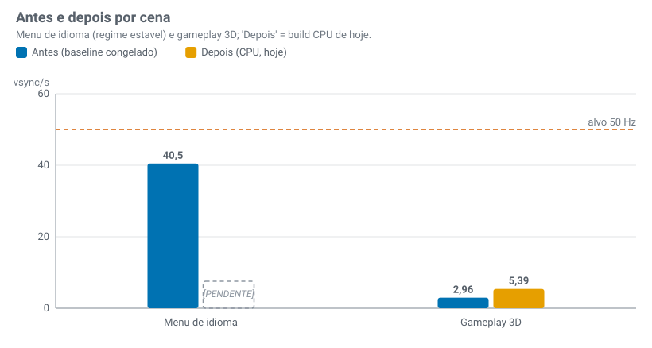
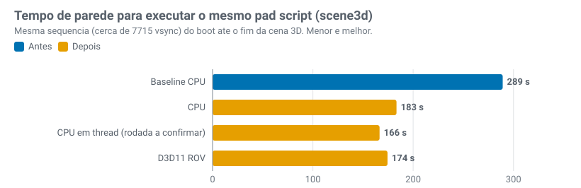
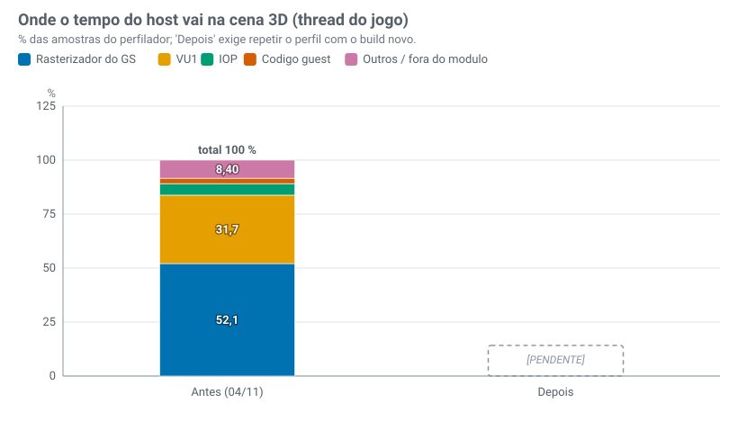
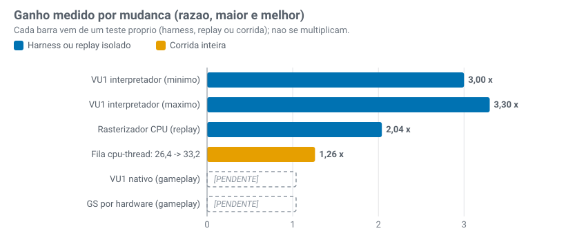

# Relatório de desempenho: antes e depois

Medição final de 05/11/2026. Os números e as fontes de cada gráfico estão em [`perf/data.json`](perf/data.json); os gráficos são regenerados por `tools\make_report.ps1` (ver o fim deste arquivo). Nenhum byte, imagem ou captura do jogo entra aqui: só números, nomes e código nossos. O que ainda não foi medido segue marcado **[PENDENTE]**.

## 1. Resumo executivo

A cena 3D de gameplay foi de **2,96 para 22,95 vsync/s: cerca de 7,8x** (22,95 / 2,96 = 7,75). Mesmo assim, **ainda estamos cerca de 2x abaixo do alvo de 50 vsync/s** (46% do alvo). A meta não foi atingida.

Medição final: mesmo executável congelado (`work/final_exe`, md5 em `logs/perf/final_exe.md5`), mesmo pad script `scene3d`, máquina quase parada, janela de vsync acumulado 7530-7640, `tools/perf_run.ps1`, uma corrida por configuração.

| Configuração | vsync/s na janela | Carga do sistema ao iniciar | CPU médio (núcleos) | RAM de pico | GPU médio |
|---|---:|---:|---:|---:|---:|
| Baseline (antes de tudo, 04/11) | 2,96 | n/d | n/d (sem medição de CPU/RAM) | n/d | n/d |
| CPU serial | 7,15 | 16% | 1,28 | 229 MB | 4,0% |
| CPU em faixas (8 trabalhadores) | 22,12 | 3% | 2,10 | 300 MB | 5,6% |
| **GS por hardware (thread própria)** | **22,95** | 0% | 1,19 | 333 MB | 12,6% |
| GS por hardware serial | 22,71 | 12% | 1,17 | 329 MB | 12,6% |

Progressão: 2,96 -> 7,15 (CPU serial) -> 22,12 (faixas) -> 22,95 (hardware). Nota: CPU em faixas e GS por hardware chegam praticamente ao mesmo ponto (22,1 a 23,0); a diferença de 3,7% entre elas está dentro do que esperamos de ruído de uma corrida única. A thread própria do GS por hardware (22,95) contra a serial (22,71) também não se separa do ruído.

| Outras métricas | Antes | Depois | Estado |
|---|---:|---:|---|
| Tempo de parede do mesmo script de pad | 289,3 s | 160,9 a 178,8 s | medido |
| Menu de idioma, Hz (regime estável) | ~40,5 | **[PENDENTE]** | baseline do estágio anterior |
| Build: editar um header comum | 12+ min (720 s) | 34,6 s (42 passos, 0 unidades do runner) | medido |
| Build: rebuild completo | ~12,5 min | ~12,5 min uma vez (custo único ao aplicar o prelude) | medido |
| Build: tocar 1 `.cpp` de gs | 14,6 s | **[PENDENTE]** | não remedido |
| Build `build_dev` (/Od): link | n/d | **[PENDENTE]** | o link falhou na hora da medição; preencher |
| RAM por `cl.exe` | 2,4 GB | 0,5 GB (só árvore `/Od` de desenvolvimento) | medido |
| CRT (pós-processamento) | n/d | custo **[PENDENTE]** | `postfx-crt.md` |



*Gráfico `fps-gameplay`: vsync/s na janela de gameplay para cada configuração; a linha tracejada é o alvo de 50 Hz.*

## 2. Metodologia

- **Máquina:** Ryzen 7 5700X3D (8 núcleos, 16 threads lógicas), 31,9 GB de RAM, Windows 11, MSVC 14.44.
- **Cena:** script de pad `pad_scripts/scene3d.txt` (relógio do guest), que vai do boot à cena 3D e termina com `quit` por volta do vsync 7720.
- **Métrica principal:** `guest_vsync_hz` do CSV por segundo do `PS2X_FPS_LOG` (colunas `t_s,fps,avg_ms,max_ms,guest_vsync_hz`). O vsync acumulado é a soma de `guest_vsync_hz x dt`; a taxa da **janela 7530-7640** é `110 / (t no vsync 7640 - t no vsync 7530)`, com interpolação linear dentro do segundo. Alinhar pelo vsync acumulado (e não pelo relógio) compara a mesma cena em todas as corridas.
- **Fontes dos dados:** `logs/perf/final_*.summary.json`, `final_*.fps.csv` e `final_*.cpu.csv` (corridas finais de 05/11), `logs/final/baseline_cpu.csv` (baseline), `docs/gameplay-profile-2026-11-04.md` e `docs/gameplay-profile-hw2-2026-11-05.md` (perfis do host), `build-speedup.md`, `vu1-optimization.md`, `vu1-native.md`, `gs-raster-cpu.md`, `gs-threading.md`, `gs-gpu-stage2.md`, `gs-gpu-measurements.md`, `vfs-ram-cache.md`.
- **Ferramentas:** `tools/perf_run.ps1` (amostra CPU total e por thread, RAM e GPU a cada 1 s e grava o resumo), `tools/report_charts.py` (SVG), `ghost_pc/tools/make_report.ps1`.

### Ressalvas de medição

1. **Uma corrida por configuração.** Não há repetição estatística. A variação entre janelas de 10 s no baseline foi de 2,6 a 3,0 (cerca de 7%); diferenças menores que isso entre configurações (por exemplo 22,12, 22,71 e 22,95) não são conclusivas.
2. **Resolução de 1 s do CSV.** `guest_vsync_hz` é gravado uma vez por segundo; a janela de 110 vsync dura 5 a 15 s e a taxa vem de **interpolação linear** do instante em que o vsync acumulado cruza 7530 e 7640. O erro de borda é de ordem 1 s sobre a duração da janela, ou seja, até alguns por cento nas corridas rápidas.
3. **Carga do sistema.** A máquina estava quase parada, mas não vazia: 16%, 3%, 0% e 12% de CPU do sistema ao iniciar (`loadavg_hint_pct`), na ordem CPU serial, faixas, hardware e hardware serial. A corrida do CPU serial (16%) e a do hardware serial (12%) tiveram mais interferência potencial.
4. **Baseline congelado.** 2,96 vsync/s foi medido em 04/11 com a ferramenta antiga, sem CPU/RAM/GPU, e não foi repetido com o exe congelado; o perfil do host de 04/11 e o build de 12 min também são anteriores. O menu a ~40,5 Hz é de um estágio anterior (`gs-optimization.md`).
5. **"CPU médio" dos `summary.json` está subestimado.** A última amostra de cada `cpu.csv` é negativa (o tempo de CPU do processo que encerra "volta"); o `cpu_cores_mean` dos JSON a inclui e dá 0,61 / 0,99 / 0,56 / 0,55 núcleos. Esta tabela usa a média recalculada **sem essa amostra** (1,28 / 2,10 / 1,19 / 1,17). `perf_run.ps1` já foi corrigido para não registrá-la nas próximas rodadas; os arquivos de log originais ficam como estão.
6. **Como ler CPU em modo de faixas.** O CPU do processo (soma de todas as threads) é a mesma medida em todas as configurações, então 2,10 núcleos para as faixas inclui os 8 trabalhadores. Mas é média da corrida inteira, **incluindo a abertura e as cenas leves**, em janelas de 1 s; os trabalhadores só trabalham nos quadros pesados. Na cena 3D o pico foi 4,27 núcleos (faixas) contra 1,91 (CPU serial) e 2,28 (hardware); os pontos de menos de 1 s de pico entre amostras não aparecem. As quatro threads mais quentes por amostra estão no CSV.
7. **Razões de harness não se multiplicam.** VU1 nativo (~4x) e rasterizador (2,04x) foram medidos isolados (harness e replay); no jogo o ganho total é limitado pelo que sobra (lei de Amdahl).
8. **Primeiros segundos.** A abertura do CSV (primeira linha) tem picos de carga de arquivos; não entram na janela.

## 3. FPS



*Gráfico `fps-serie-tempo`: linhas de `guest_vsync_hz` por segundo de parede, uma por corrida. Até a cena 3D todas ficam perto de 50 (limite do jogo); no fim a queda marca a gameplay 3D. As corridas novas terminam antes (161 a 179 s contra 289 s) porque a cena 3D passa mais rápido.*


*Gráfico `fps-serie-vsync`: o mesmo dado com o eixo X em vsync acumulado, recortado em 7300-7720; a faixa cinza é a janela de medição 7530-7640. A queda acontece no mesmo ponto do jogo (~vsync 7520) em todas as corridas; o baseline fica em 2-4 e as quatro configurações finais entre 7 e 23.*



*Gráfico `fps-cenas`: antes/depois por cena. O menu "depois" está **[PENDENTE]**.*



*Gráfico `tempo-script`: tempo de parede para o mesmo script de pad (cerca de 7715 vsync): 289,3 s para 160,9 a 178,8 s (1,6x a 1,8x). Como o relógio do guest é fixo, esse tempo só cai nas fases pesadas, e o fim ainda corre abaixo de 50 vsync/s.*

## 4. Build


*Gráfico `build-tempos`: escala **logarítmica** (cada divisão é 10x). Azul o antes, laranja o depois; barras tracejadas ainda não medidas (tocar 1 `.cpp` de gs).*


*Gráfico `build-ram`: pico de memória por `cl.exe` no build de desempenho (2,4 GB) e na árvore `/Od` de desenvolvimento (0,5 GB).*

Causa do problema antigo: o PCH incluía `ps2_runtime.h`, e o ninja o tratava como dependência das 1307 unidades unity; editar qualquer um dos 22 headers do fechamento (46 665 linhas) refazia tudo. O "prelude leve" reduz o fechamento para 11 headers: editar `ps2_vu1.h` ou `gs_frontend.h` passa a tocar 0 unidades do runner (**34,6 s** medidos, 42 passos, contra 12+ min). Aplicar o prelude exigiu **um** rebuild completo (~12,5 min), que é custo único. O link da árvore `build_dev` (/Od) falhou na hora da medição, então o tempo dessa árvore está **[PENDENTE]**. Detalhes e riscos em `build-speedup.md`. A árvore `/Od` serve só para iterar, **nunca para medir FPS**.

## 5. Desempenho por componente (perfil do host)



*Gráfico `host-composicao`: amostras do perfilador na thread do jogo. "Antes" (04/11, renderer CPU): rasterizador 52,1%, VU1 31,7%, IOP 5,3%, guest 2,5%, outros 8,4%. "Depois" (perfil 2, 05/11, renderer hw, `gameplay-profile-hw2-2026-11-05.md`) só tem quatro categorias publicadas: VU1 23%, guest+VU0 17,1%, runtime EE 11,5%, espera ociosa 10,1%; as categorias não detalhadas aparecem em branco. Os dois perfis são de renderers diferentes: não são comparação 1:1.*


*Gráfico `host-rasterizador` (antes): `DrawSprite` 25,5%, `DrawTriangle` 17,2%, VRAM/textura 8,1%, resto do GS 1,2% (soma 52,1%), contra VU1, IOP, guest e tempo fora do módulo.*

Observação do perfilador: ele amostra só a thread do jogo, então as porcentagens são da thread do jogo. No perfil 2, o rasterizador saiu da thread do jogo (GS por hardware em thread própria) e o que sobra é VU1 (23%), código guest e VU0 (17,1%) e o runtime do EE (11,5%); 10,1% é espera ociosa, ou seja, há folga para o próximo gargalo, que é o custo do guest/VU em si.



*Gráfico `ganhos-por-mudanca`: razão medida de cada mudança, separando testes isolados (harness/replay) de corridas inteiras (vsync/s). Os testes foram feitos em momentos diferentes, com bases diferentes: as barras não se multiplicam. O cache de VFS não trouxe ganho.*

## 6. Uso de CPU, RAM e GPU


*Gráfico `uso-cpu`: núcleos usados pelo processo por segundo, a partir de `logs/perf/final_*.cpu.csv`; 1,0 é um núcleo cheio de 16 lógicos. As faixas (laranja) sobem a 3-4 núcleos nos quadros pesados.*


*Gráfico `uso-ram-gpu`: média de núcleos por configuração (sem a amostra final negativa, ressalva 5).*

| Configuração | Núcleos médios | Pico (núcleos) | % de 16 threads | RAM de pico | GPU médio |
|---|---:|---:|---:|---:|---:|
| CPU serial | 1,28 | 1,91 | 8,0% | 229 MB | 4,0% |
| CPU em faixas | 2,10 | 4,27 | 13,1% | 300 MB | 5,6% |
| GS hardware (thread) | 1,19 | 2,28 | 7,5% | 333 MB | 12,6% |
| GS hardware serial | 1,17 | 2,10 | 7,3% | 329 MB | 12,6% |

Leitura: o port usa pouco da máquina (no máximo ~13% das 16 threads em média). O gargalo é a thread do jogo (EE, VU1, escalonadores), a mais quente a 70-77% de um núcleo em todas as corridas; mais núcleos só ajudam onde o trabalho é paralelizável (faixas do rasterizador, GS em thread). No GS por hardware a GPU sobe de 4% para 12,6%, sem pressionar a placa.

Como medir: `tools/perf_run.ps1` roda o port com `PS2X_FPS_LOG`, amostra a cada 1 s o tempo de CPU do processo e de cada thread (as 4 mais quentes), working set e pico, e GPU via contadores `GPU Engine` do Windows (filtrados pelo PID; usa o maior tipo de engine). Gera `<tag>.cpu.csv`, `<tag>.fps.csv` e `<tag>.summary.json`.

Exemplo:

```
cd ghost_pc
powershell -NoProfile -File ..\tools\perf_run.ps1 -Tag final_cpu -TimeoutSec 400 `
  -Exe work\final_exe\ps2EntryRunner.exe -ExeArgs work\SLES_530.20 `
  -PadScript pad_scripts\scene3d.txt `
  -Env @{PS2X_GS='cpu'; PS2X_TARGET_FPS='0'; PS2X_VIDEO_HZ='50'; PS2X_HEARTBEAT='1'}
```

Com `powershell -File` use `-Env "PS2X_GS=cpu;PS2X_TARGET_FPS=0"` (texto) no lugar da hashtable. Ajuste as tags em `perf/data.json` (`uso-cpu`) ao trocar de rodada.

## 7. O que cada mudança contribuiu

| Mudança | Efeito medido | Onde |
|---|---|---|
| Interpretador VU1 otimizado | 3,0-3,3x no harness; chamada vazia 8,8x | `vu1-optimization.md` |
| VU1 nativo | ~4x no harness (113 -> ~28 ns/ciclo); hoje ~6,1 us por chamada, ~25 ns/ciclo | `vu1-native.md` |
| Rasterizador de GS em CPU (SIMD, blend, escrita) | 2,04x no replay | `gs-raster-cpu.md` |
| Faixas de CPU (8 trabalhadores) | 11,4 -> 18,8 vsync/s | `gs-threading.md` |
| Fila `cpu-thread` (histerese, lote, 32 MiB) | esperas do produtor 400 mil -> 280 por 10 s; vsync da corrida 26,4 -> 33,2 | `gs-threading.md` |
| GS por hardware: lotes e readbacks | 12,2 -> 18,8 vsync/s | `gs-gpu-measurements.md` |
| GS por hardware em thread própria | 18,8 -> ~21-22 (indicativo) | `gs-gpu-stage2.md` |
| Escalonador do EE sem sono em tempo real quando atrasado | 18,7 -> 22,3 (indicativo) | commit `7771f1e` |
| Escalonador do IOP | 22% -> ~5% da thread do jogo | perfil do host |
| Cache de VFS na RAM | **sem ganho** (180,9 s contra 179,4 s) | `vfs-ram-cache.md` |
| CRT (pós-processamento) | custo **[PENDENTE]** | `postfx-crt.md` |
| Prelude leve do runner | editar header 12+ min -> 34,6 s | `build-speedup.md` |

Atribuir o ganho de 2,96 para 22,95 a cada mudança exige medir uma por vez; hoje só há as razões isoladas acima, medidas em momentos diferentes e com bases diferentes.

## 8. Limitações e riscos

- A meta (50 vsync/s na gameplay 3D) **não foi atingida**: o melhor caso medido (22,95) está cerca de 2x abaixo.
- Uma corrida por configuração, sem repetição estatística; janela por interpolação sobre CSV de 1 s (seção 2, ressalvas 1 e 2).
- As três configurações rápidas (22,1 a 23,0) não se distinguem de forma conclusiva.
- `cpu-thread` aumenta a latência de `Present` (0,3-0,9 s na gameplay) com a fila de 32 MiB.
- A medição de GPU depende dos contadores do Windows e pode vir vazia em alguns drivers.
- A árvore `/Od` e o prelude leve têm riscos descritos em `build-speedup.md` (ODR benigno guardado por script, assembly idêntico só verificado em amostra).

## 9. Próximos passos

1. Repetir cada configuração (3 corridas) para ter média e dispersão, e distinguir faixas e hardware.
2. Atacar o que o perfil 2 mostra: VU1 (23%), guest+VU0 (17,1%) e runtime do EE (11,5%) na thread do jogo.
3. Medir o menu de idioma, o custo do CRT e o tempo de tocar 1 `.cpp` de gs; preencher o link do `build_dev`.
4. Repetir o perfil do host com o mesmo renderer do "antes" para uma comparação 1:1.

## Como regenerar

```
powershell -NoProfile -File ghost_pc\tools\make_report.ps1
```

Edite os números em `docs/perf/data.json` (campo `values`/`value`; use `null` para pendente), rode o comando e os SVG em `docs/img/` são reescritos e validados (XML e texto). O formato do JSON está documentado no cabeçalho de `tools/report_charts.py`. Log: `logs/make_report.log` e `logs/report_charts.log`.
