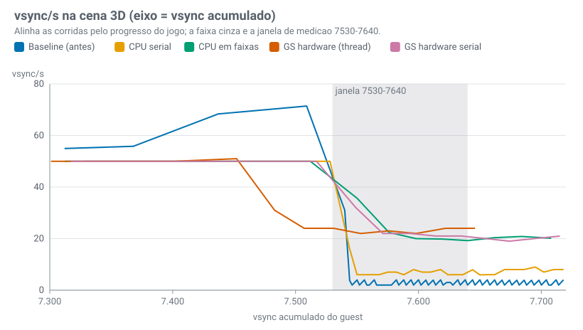
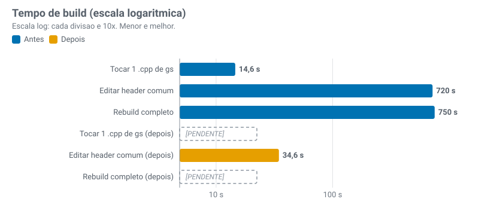
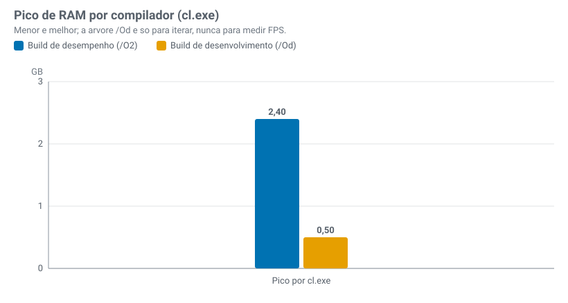
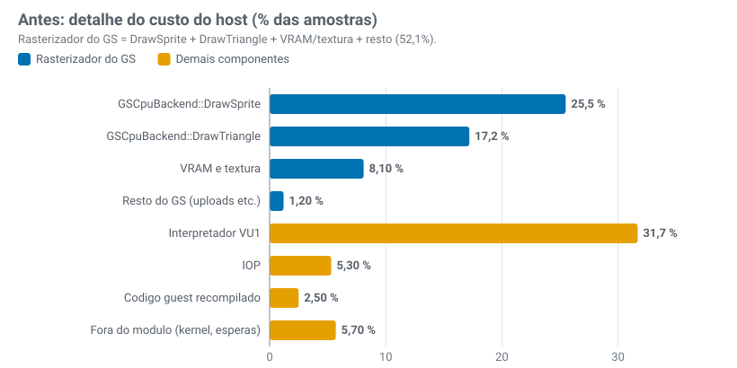
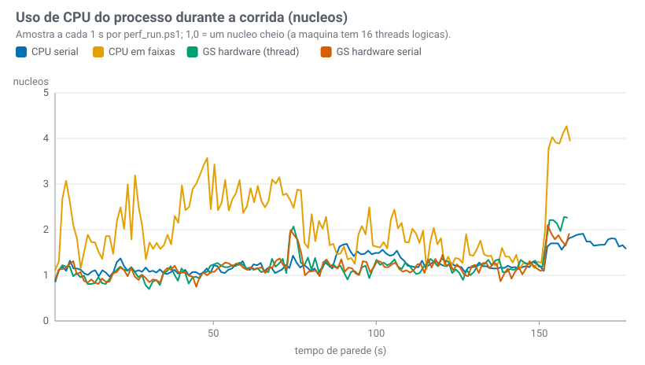
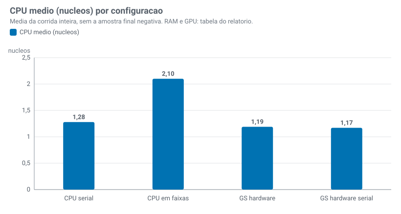

# Relatório de desempenho: antes e depois

Rascunho gerado em 05/11/2026 com os dados que já existem. Tudo o que depende da medição final está marcado **[PENDENTE]**. Os números e as fontes de cada gráfico estão em [`perf/data.json`](perf/data.json); os gráficos são regenerados por `tools\make_report.ps1` (ver o fim deste arquivo). Nenhum byte, imagem ou captura do jogo entra aqui: só números, nomes e código nossos.

## 1. Resumo executivo

| Métrica | Antes | Depois (hoje) | Estado |
|---|---:|---:|---|
| Gameplay 3D, vsync/s (janela 7530-7640, alvo 50) | 2,96 | CPU 5,39; D3D11 ROV 6,87; CPU em thread **[PENDENTE]** | medido, máquina possivelmente carregada |
| Menu de idioma, Hz (regime estável) | ~40,5 | **[PENDENTE]** | baseline do estágio anterior |
| Tempo para rodar o mesmo script de pad | 289,3 s | CPU 183,4 s; D3D11 174,4 s; CPU em thread 166,5 s (a confirmar) | medido (CSV de `logs/final`) |
| Interpretador VU1 | 1x | 3,0 a 3,3x (harness) | medido |
| Rasterizador de GS em CPU | 1x | 2,04x (replay) | medido |
| Fila `cpu-thread`, vsync da corrida inteira | 26,4 | 33,2 (+26%) | medido |
| Build: editar um header comum | 12+ min (720 s) | 34,6 s (42 passos, 0 unidades do runner) | medido |
| Build: tocar 1 `.cpp` de gs | 14,6 s | **[PENDENTE]** | não remedido |
| Build: rebuild completo | ~12,5 min (1307 unidades unity) | **[PENDENTE]** | não remedido |
| RAM por `cl.exe` | 2,4 GB | 0,5 GB (só árvore `/Od` de desenvolvimento) | medido |
| VU1 nativo, GS por hardware, CRT, cache de VFS | n/d | **[PENDENTE]** | campos prontos em `data.json` |

Leitura honesta: a cena 3D de gameplay passou de 3% do alvo (2,96 de 50 vsync/s) para 11-14% (5,4 a 6,9). É uma melhora real (1,8x a 2,3x), mas **a meta de 50 vsync/s não foi atingida**. O maior ganho concreto até agora é o de produtividade: editar um header deixou de custar 12 minutos.


*Gráfico `fps-gameplay`: barras do vsync/s na janela de gameplay para cada configuração; a linha tracejada é o alvo de 50 Hz. Barras tracejadas com "[PENDENTE]" ainda não foram medidas.*

## 2. Metodologia

- **Máquina:** Ryzen 7 5700X3D (8 núcleos, 16 threads lógicas), 31,9 GB de RAM, Windows 11, MSVC 14.44.
- **Cena:** script de pad `pad_scripts/scene3d.txt` (relógio do guest), que vai do boot à cena 3D e termina com `quit` por volta do vsync 7720.
- **Métrica principal:** `guest_vsync_hz` do CSV por segundo do `PS2X_FPS_LOG` (colunas `t_s,fps,avg_ms,max_ms,guest_vsync_hz`). O vsync acumulado é a soma de `guest_vsync_hz x dt`; a taxa da **janela 7530-7640** é `110 / (t no vsync 7640 - t no vsync 7530)`, com interpolação linear dentro do segundo. Alinhar pelo vsync acumulado (e não pelo relógio) compara a mesma cena em todas as corridas.
- **Fontes dos dados:** `logs/final/*.csv` (corridas de 05/11), `docs/gameplay-profile-2026-11-04.md` (baseline e perfil do host), `build-speedup.md`, `vu1-optimization.md`, `gs-raster-cpu.md`, `gs-threading.md`, `gs-gpu-stage2.md`.
- **Ferramentas:** `tools/perf_run.ps1` (amostra CPU total e por thread, RAM e GPU a cada 1 s e grava o resumo), `tools/report_charts.py` (SVG), `ghost_pc/tools/make_report.ps1`.

### Ressalvas de medição

1. **Máquina carregada x parada.** Os outros agentes compilavam enquanto parte dos testes rodava. Valem as razões; os valores absolutos podem mudar na medição final com a máquina parada. `perf_run.ps1` registra `loadavg_hint_pct` (CPU do sistema ao iniciar) para saber se a rodada foi limpa.
2. **Divergência de janela.** Recalculei a janela 7530-7640 dos CSV por interpolação e obtive 3,02 (baseline), 6,06 (CPU), 7,10 (D3D11) e 12,1 (CPU em thread), contra 2,96, 5,39 e 6,87 usados aqui (valores do líder). A diferença (2% a 12%) vem de como se delimita a janela e se interpola; **a medição final deve usar a definição de `perf_run.ps1`** (interpolação) para todas as configurações. O 12,1 do `cpu-thread` vem de uma rodada que o líder marcou como incompleta: não confiar.
3. **Baselines congelados.** 2,96 vsync/s, o perfil do host e o build de 12 min são de 04/11 e não foram repetidos; o menu a ~40,5 Hz é de um estágio anterior (`gs-optimization.md`).
4. **Razões de harness não se multiplicam.** VU1 3,0-3,3x e rasterizador 2,04x foram medidos isolados (harness e replay); no jogo o ganho total é limitado pelo que sobra (lei de Amdahl).
5. **Primeiros segundos.** A abertura do CSV (primeira linha) tem picos de carga de arquivos; não entram na janela.

## 3. FPS


*Gráfico `fps-serie-tempo`: linhas de `guest_vsync_hz` por segundo de parede, uma por corrida. Até a cena 3D todas ficam perto de 50 (limite do jogo); no fim a queda para uma taxa de um dígito marca a gameplay 3D. As corridas novas terminam antes (183 s contra 289 s) porque a cena 3D lenta ocupa menos tempo.*



*Gráfico `fps-serie-vsync`: o mesmo dado com o eixo X em vsync acumulado, recortado em 7300-7720; a faixa cinza é a janela de medição 7530-7640. A queda acontece no mesmo ponto do jogo (~vsync 7520) em todas as corridas. A linha do baseline oscila em dente de serra perto de 2-4; as novas ficam em 5-8 (CPU e ROV) e perto de 11 (CPU em thread, rodada a confirmar).*


*Gráfico `fps-cenas`: barras agrupadas antes/depois por cena (menu e gameplay). O menu "depois" está **[PENDENTE]**.*


*Gráfico `tempo-script`: barras horizontais com o tempo de parede para o mesmo script de pad (cerca de 7715 vsync). Como o relógio do guest é fixo, esse tempo cai quando o port acompanha melhor o guest nas fases pesadas: 289,3 s para 166-183 s (1,6x a 1,7x).*

## 4. Build



*Gráfico `build-tempos`: barras horizontais em escala **logarítmica** (cada divisão é 10x) para tocar um `.cpp`, editar um header e rebuild completo, antes e depois. Em azul o antes; em laranja o depois; barras tracejadas ainda não medidas.*



*Gráfico `build-ram`: pico de memória por `cl.exe` no build de desempenho (2,4 GB) e na árvore `/Od` de desenvolvimento (0,5 GB).*

Causa do problema antigo: o PCH incluía `ps2_runtime.h`, e o ninja o tratava como dependência das 1307 unidades unity; editar qualquer um dos 22 headers do fechamento (46 665 linhas) refazia tudo. O "prelude leve" reduz o fechamento para 11 headers: editar `ps2_vu1.h` ou `gs_frontend.h` passa a tocar 0 unidades do runner (34,6 s de medição, 42 passos). Detalhes e riscos em `build-speedup.md`. A árvore `/Od` (4x a 50x mais rápida por unidade) serve só para iterar, **nunca para medir FPS**.

## 5. Desempenho por componente (perfil do host)


*Gráfico `host-composicao`: barras empilhadas com a divisão das amostras do perfilador na thread do jogo: rasterizador 52,1%, VU1 31,7%, IOP 5,3%, guest 2,5%, outros 8,4%. A barra "Depois" está **[PENDENTE]** até repetir o perfil com o build novo.*



*Gráfico `host-rasterizador`: barras horizontais com o detalhe do antes: `DrawSprite` 25,5%, `DrawTriangle` 17,2%, VRAM/textura 8,1%, resto do GS 1,2% (soma 52,1%), contra VU1, IOP, guest e tempo fora do módulo.*

Observação do perfilador: ele amostra só a thread do jogo (não a de janela nem a de GS no `cpu-thread`), então as porcentagens são da thread do jogo.


*Gráfico `ganhos-por-mudanca`: razão medida de cada mudança, separando testes isolados (VU1, rasterizador) de corridas inteiras (fila `cpu-thread`). VU1 nativo e GS por hardware estão **[PENDENTE]**.*

## 6. Uso de CPU, RAM e GPU



*Gráfico `uso-cpu`: linhas do CPU% do processo (em relação a 16 threads lógicas) por segundo, a partir de `logs/perf/<tag>.cpu.csv`. **[PENDENTE]**: ainda não há rodadas de medição final.*



*Gráfico `uso-ram-gpu`: CPU médio por renderer. RAM de pico e GPU% médio ficam no JSON de resumo (`logs/perf/<tag>.summary.json`). **[PENDENTE]**.*

Como medir: `tools/perf_run.ps1` roda o port com `PS2X_FPS_LOG`, amostra a cada 1 s o tempo de CPU do processo e de cada thread (as 4 mais quentes), working set e pico, e GPU via contadores `GPU Engine` do Windows (filtrados pelo PID; usa o maior tipo de engine). Gera `<tag>.cpu.csv`, `<tag>.fps.csv` e `<tag>.summary.json`. Prova de funcionamento (rodada curta de 12-30 s, só na abertura, **não é medida de desempenho**): ~1,1 núcleo (7% de 16 threads), ~170 MB, uma thread a ~83% de um núcleo e duas a 12-18%.

Exemplo para a rodada final:

```
cd ghost_pc
powershell -NoProfile -File ..\tools\perf_run.ps1 -Tag novo_cpu -TimeoutSec 400 `
  -Exe work\ps2recomp_game\out\build_perf\ps2xRuntime\ps2EntryRunner.exe -ExeArgs work\SLES_530.20 `
  -PadScript pad_scripts\scene3d.txt `
  -Env @{PS2X_GS='cpu'; PS2X_TARGET_FPS='0'; PS2X_VIDEO_HZ='50'; PS2X_HEARTBEAT='1'}
```

Com `powershell -File` use `-Env "PS2X_GS=cpu;PS2X_TARGET_FPS=0"` (texto) no lugar da hashtable. Para os gráficos de CPU, ajuste as tags em `perf/data.json` (`uso-cpu`).

## 7. O que cada mudança contribuiu

| Mudança | Efeito medido | Onde |
|---|---|---|
| Interpretador VU1 otimizado | 3,0-3,3x no harness; chamada vazia 8,8x; meta de 4x não atingida | `vu1-optimization.md` |
| Rasterizador de GS em CPU (SIMD, blend, escrita) | 2,04x no replay | `gs-raster-cpu.md` |
| Fila `cpu-thread` (histerese, lote, 32 MiB) | esperas do produtor 400 mil -> 280 por 10 s; vsync da corrida 26,4 -> 33,2 | `gs-threading.md` |
| Prelude leve do runner | editar header 12+ min -> 34,6 s | `build-speedup.md` |
| Renderer D3D11 ROV | 6,87 vsync/s na gameplay (hoje, máquina carregada) | `gs-gpu-stage2.md` |
| VU1 nativo | **[PENDENTE]** | `vu1-native.md` |
| GS por hardware | **[PENDENTE]** | `gs-gpu-stage2.md`, `gs-gpu-measurements.md` |
| CRT (pós-processamento) | custo **[PENDENTE]** | `postfx-crt.md` |
| Cache de VFS na RAM | **[PENDENTE]** | `vfs-ram-cache.md` |

Atribuir o ganho de 2,96 para 5,39 a cada mudança exige medir uma por vez; hoje só há as razões isoladas acima.

## 8. Limitações e riscos

- A meta (50 vsync/s na gameplay 3D) segue distante: faltam ~7x no melhor caso medido.
- Números de gameplay vêm de poucas corridas, sem repetição estatística; a variação entre janelas de 10 s no baseline foi de 2,6 a 3,0.
- A janela de vsync é sensível ao método de recorte (seção 2, ressalva 2).
- `cpu-thread` aumenta a latência de `Present` (0,3-0,9 s na gameplay) com a fila de 32 MiB.
- A medição de GPU depende dos contadores do Windows e pode vir vazia em alguns drivers.
- A árvore `/Od` e o prelude leve têm riscos descritos em `build-speedup.md` (ODR benigno guardado por script, assembly idêntico só verificado em amostra).

## 9. Próximos passos

1. Com a máquina parada, rodar `perf_run.ps1` para `baseline`, `novo_cpu`, `novo_cputhread`, `novo_d3d11` (e VU1 nativo e `hw`) e substituir os **[PENDENTE]** em `perf/data.json`.
2. Repetir o perfil do host (`PS2X_PROFILE_SECONDS`) para a barra "Depois" de `host-composicao`.
3. Remedir o build: tocar 1 `.cpp` de gs e rebuild completo com o prelude.
4. Medir o menu de idioma com o build novo.
5. Atacar o que o perfil mostra: rasterizador (`DrawSprite` e `DrawTriangle`, ~43% do host) e VU1 (~32%).

## Como regenerar

```
powershell -NoProfile -File ghost_pc\tools\make_report.ps1
```

Edite os números em `docs/perf/data.json` (campo `values`/`value`; use `null` para pendente), rode o comando e os SVG em `docs/img/` são reescritos e validados (XML e texto). O formato do JSON está documentado no cabeçalho de `tools/report_charts.py`. Log: `logs/make_report.log` e `logs/report_charts.log`.
